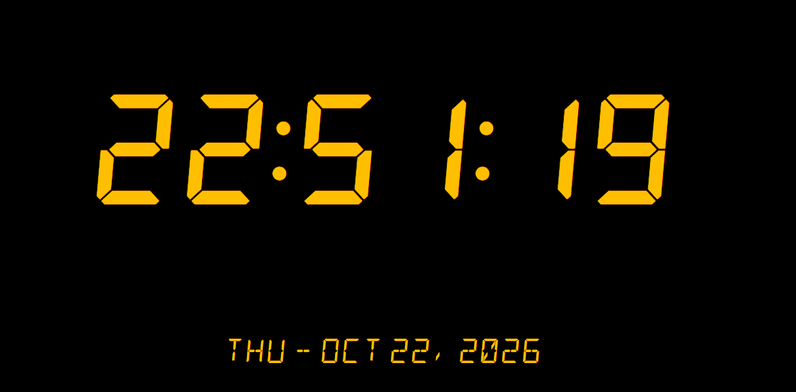
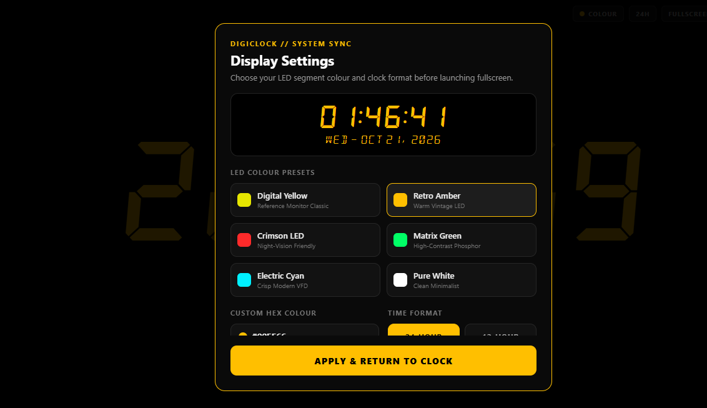

# DigiClock





A fullscreen digital desk clock for **Windows 10 Desktop** and **Android Mobile**, modeled after `assets/digiclock.png`.

## Features

- **Full-Screen Pure Black Display (`#000000`)**: Zero distractions, hidden status bar and menu bar.
- **75% Screen-Width 7-Segment Time (`HH:MM:SS`)**: Uses `DSEG7Classic-BoldItalic` (`assets/fonts/DSEG7Classic-BoldItalic.ttf`) scaled dynamically so all 6 digits and both colons fill 75% of the screen width without clipping.
- **Bottom-Center 14-Segment Date (`DAY - MONTH DATE, YEAR`)**: Displays e.g. `WED - OCT 21, 2026` in `DSEG14Classic-Italic`.
- **Millisecond-Aligned System Clock Sync**: Ticks on the exact boundary of each system second (`1000 - now.getMilliseconds()`) with 24-hour (default) and 12-hour modes.
- **Startup LED Color Configuration**: Choose from classic LED presets (**Digital Yellow** `#E6E600`, **Retro Amber**, **Crimson LED**, **Matrix Green**, **Electric Cyan**, **Pure White**) or enter any custom Hex color upon startup, with an auto-hiding top-right quick bar while running.
- **Always-On Screen Wake Lock**: Prevents phone and desktop monitors from sleeping (`expo-keep-awake` + Electron `powerSaveBlocker`).

## Project Structure

- `src/app/_layout.tsx` — Root layout and `DSEG7`/`DSEG14` font loader
- `src/app/index.tsx` — Main clock screen, startup modal state, and Electron/Web fullscreen bridge
- `src/components/DigitalClockDisplay.tsx` — Fullscreen clock layout and auto-hiding top-right controls
- `src/components/StartupConfigModal.tsx` — Startup LED color & 12h/24h configuration modal
- `src/hooks/useSystemClock.ts` — System clock synchronization hook
- `src/constants/colors.ts` — LED color presets and hex validation
- `electron/main.cjs` & `electron/preload.cjs` — Windows 10 native desktop wrapper
- `eas.json` — Android `.apk` cloud build profile

## Running & Building

### 1. Windows 10 Native Desktop App (`DigiClock.exe`)

From WSL2, build and copy the unpacked Windows executable directly to your Windows 10 Desktop (`C:\Users\YOUR_NAME\Desktop\DigiClock\DigiClock.exe`):

```bash
npm run desktop:build:win
```

Then open `C:\Users\YOUR_NAME\Desktop\DigiClock\DigiClock.exe` on Windows 10.

- Press **`Escape`** to exit fullscreen (e.g. to move the window to another monitor).
- Press **`F11`** to toggle fullscreen.

### 2. Android Phone

- **Instant via Expo Go (over WSL2 Tunnel)**:
  ```bash
  npm run mobile:tunnel
  ```
- **Standalone Android `.apk` (via EAS Build)**:
  ```bash
  npx eas-cli@latest login
  npm run apk:build
  ```

### 3. Web Browser (Development)

```bash
npm run web
```
